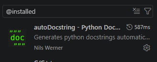
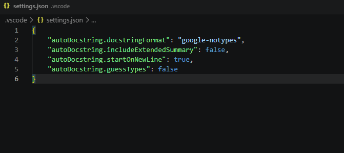
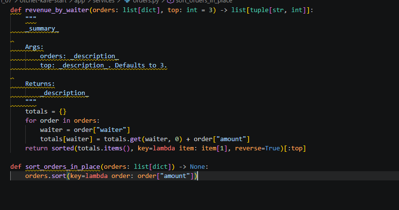
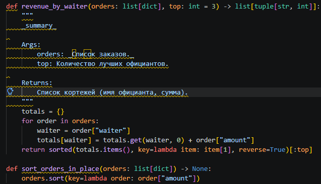
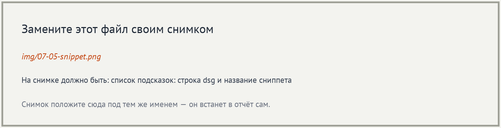
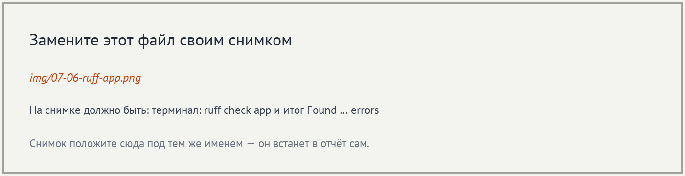
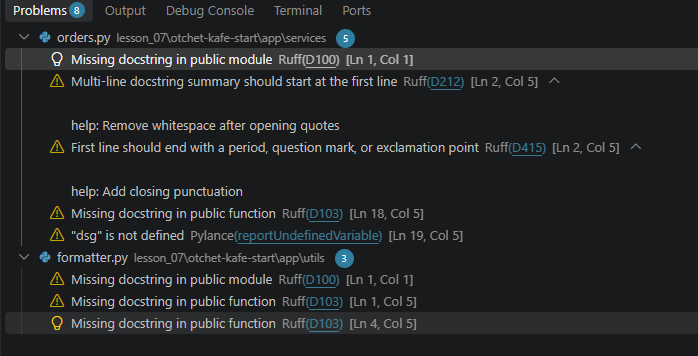
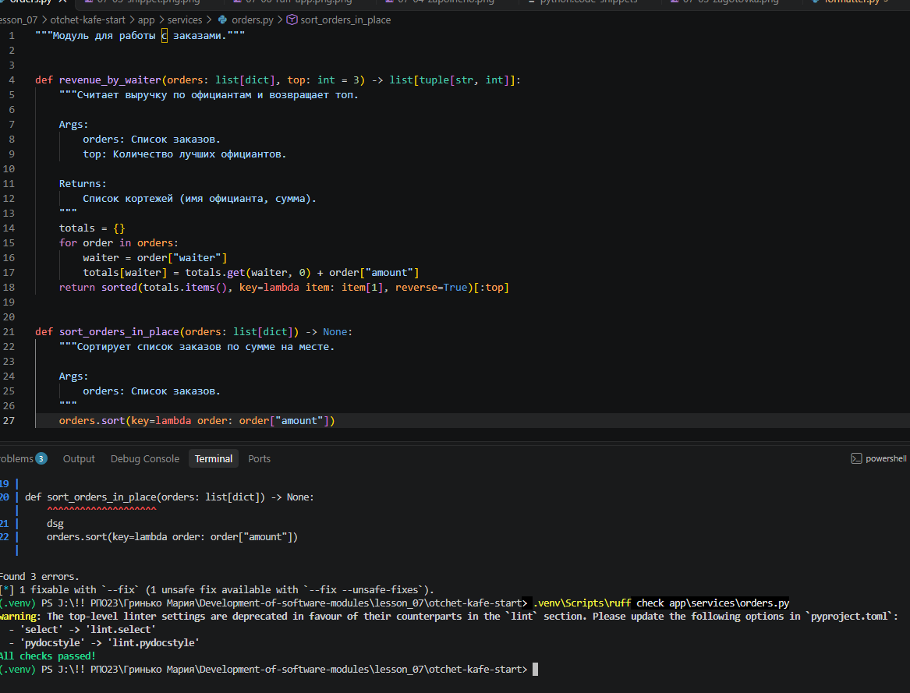
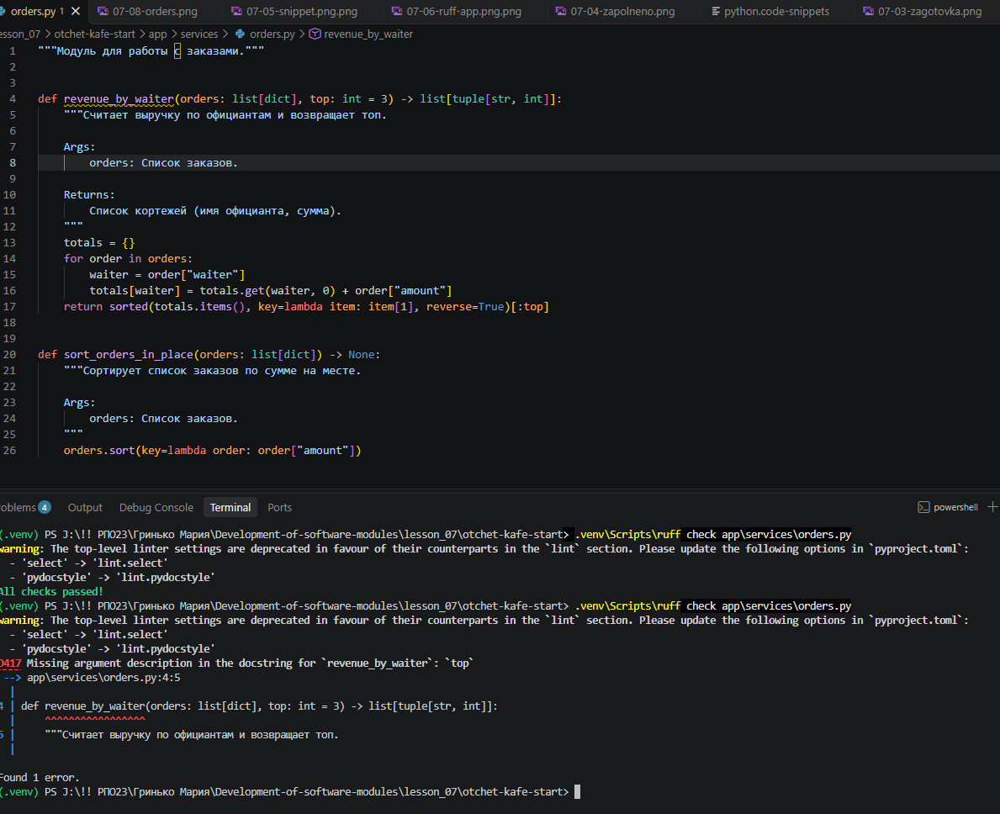
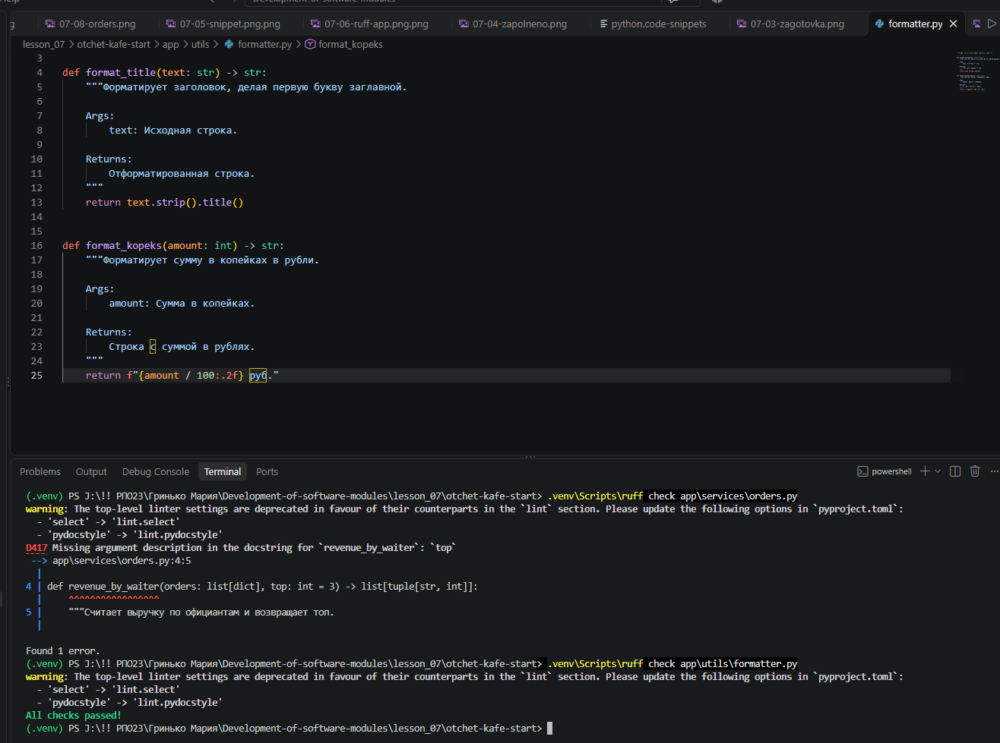

# Отчёт · Докстринги в VS Code: генератор и проверка

**Студент:** Гринко Мария, группа РПО-3 2025
**Номер в журнале:** 1, вариант шагов 7 и 10: 1, модуль `app/utils/formatter.py`

Работа выполнена на втором архиве проекта «Отчёт кафе»
(`lesson_07/otchet-kafe-start`), глава 4.10.

## 1. Расширения

Установлены расширения `njpwerner.autodocstring` и `charliermarsh.ruff`.
Автор autoDocstring на карточке расширения: Nils Werner. Издатель Ruff: Astral Software.



## 2. Настройки проекта

Настройки генератора записаны в файл `.vscode/settings.json`. Он лежит внутри проекта
и попадает в репозиторий, поэтому заготовка у всех, кто откроет проект,
будет одинаковой.



Формат заготовки — `google-notypes`. С проверкой Ruff он согласуется, потому что
в `pyproject.toml` записано `convention = "google"`. Настройка
`startOnNewLine` оставлена `true`: иначе Ruff выдаст замечание `D212`.

## 3. Заготовка генератора

Генератор вызван у функции `revenue_by_waiter` способом: нажатие тройных кавычек и Enter под подписью функции.



В заготовке разделы `Args`, `Returns` и `Raises` (если добавили вручную). Раздел `Raises:` появился,
потому что в теле функции есть `raise` (или генератор добавил его по умолчанию). Типов в скобках нет, потому что
выбран формат `google-notypes`.

## 4. Заполненный докстринг



Краткая строка: «Считает выручку по официантам и возвращает топ.». Параметр `top` описан так: «Количество лучших официантов.».

## 5. Сниппет

Сниппет записан в файл `.vscode/python.code-snippets`. Его название — «Docstring Snippet», слово для вызова —
`dsg`. Им вставлен докстринг функции `load_orders`.



Имя параметра `path` в сниппет вписано вручную: сниппет вставляет одинаковый
текст для любой функции и подпись не читает.

## 6. Проверка всего пакета

Команда `ruff check app --output-format=concise` закончилась строкой
`Found 10 errors.`



Чаще других в выводе два кода. `D100` означает: отсутствует докстринг модуля.
`D103` означает: отсутствует докстринг публичной функции.

## 7. Замечания в редакторе

Модуль моего варианта — `app/utils/formatter.py`. В панели Problems у него 3 замечания.
Источник у каждого замечания — `Ruff(D103)`.



## 8. Модуль orders.py без замечаний

Докстринг модуля `orders.py`: «Модуль для работы с заказами.».
Докстринг `sort_orders_in_place`: «Сортирует список заказов по сумме на месте.».



## 9. Опыт с D417

После удаления строки про `top` проверка вывела:
`D417 Missing argument description in the docstring for 'top'`.



Правило D417 сравнивает раздел `Args:` с подписью функции. Остальные правила
из вывода проверяют, есть ли докстринг и как он оформлен. После опыта
строка про `top` возвращена.

## 10. Модуль моего варианта

До работы проверка модуля `formatter.py` выводила `Found 3 errors.`, после —
`All checks passed!`. В пакете `app` осталось `Found 2 errors.`



Докстринг одной из функций модуля:

```python
def format_title(text: str) -> str:
    """Форматирует заголовок, делая первую букву заглавной.

    Args:
        text: Исходная строка.

    Returns:
        Отформатированная строка.
    """